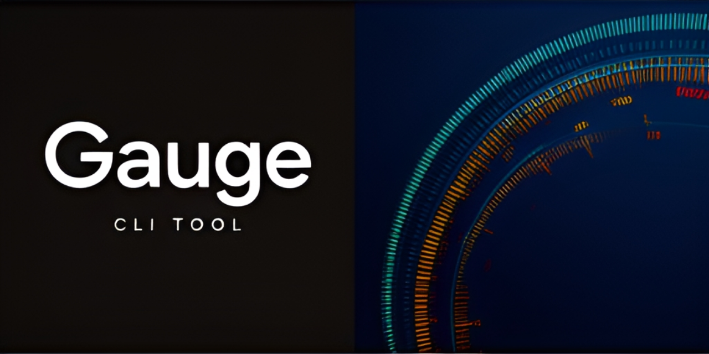

# gauge

<!-- aegean:media:start -->
<p align="center"></p>
<p align="center"></p>
<!-- aegean:media:end -->

[](https://github.com/AegeanWorks/AIKit)

A zero-dependency terminal ruler for numeric series. `gauge` reads numbers from arguments, a
file or a pipe and draws a sparkline, signed bars, a histogram, a box plot or a compact
statistics block. `stats --json` is the machine surface for another tool.

It is deliberately small: one short-lived process, no configuration, no network access and no
stored state.

## ⚡ 30-Second Cold-Start Quick Reference

- **Runtime Prerequisites**: Python 3.9 or newer (standard library only; nothing to install)
- **Canonical Regression Shield Gate**:
  ```bash
  python -m unittest discover -s tests -t .
  ```

### 🛠️ AIKit Commands (run from the AIKit folder)
| Role | Command |
|---|---|
| Status, task and gates | `python aikit.py status gauge` |
| Phase 4: every gate | `python aikit.py check gauge` |
| Repair memory and map, then check | `python aikit.py fix gauge` |
| Resume an interrupted task | `python aikit.py resume gauge` |

## 🚀 Try It

Run these from this project's root:

```bash
python -m gauge demo
python -m gauge spark 0 1 2 3 4 5 6 7 --label latency
python -m gauge bars 2 4 8 --width 20
python -m gauge hist 1 2 2 3 3 3 --bins 3 --width 12
python -m gauge box 0 25 50 75 100 --width 21
python -m gauge stats 2 3 5 8 --percentiles 50,90,95,99
python -c "print('2, 3, 5, 8')" | python -m gauge stats --json
python -m gauge bars --file latencies.txt --width 30
```

The demo needs no input and shows the sparkline and statistics surfaces:

```text
$ python -m gauge demo
gauge demo: a deterministic 24-point latency trace (milliseconds)
▆▆▇▇▇▇▆▆▆▆▅▄▃▂▁▁▁▂▃▅▆▇██

count   24
sum     1025.22
min     17.79
max     61.2
mean    42.7175
median  47.095
p90     57.69
stdev   13.3527
```

A labelled sparkline and a signed bar chart:

```text
$ python -m gauge spark 0 1 2 3 4 5 6 7 --label latency
latency ▁▂▃▄▅▆▇█

$ python -m gauge bars -4 0 6 --width 21 --ascii
-4  ########|
 0          |
 6          |############
```

The histogram bins the same series without a plotting library:

```text
$ python -m gauge hist 1 2 2 3 3 3 --bins 3 --width 12 --ascii
      [1, 1.66667)  ####          1
[1.66667, 2.33333)  ########      2
      [2.33333, 3]  ############  3
```

A horizontal 5-number box plot:

```text
$ python -m gauge box 0 25 50 75 100 --width 21 --ascii
|----[====|====]----|
min: 0  q1: 25  med: 50  q3: 75  max: 100
```

## 🧭 Commands

| Command | What it prints |
|---|---|
| `spark` | One character per value, resampled to `--width` (default 60) |
| `bars` | One labelled row per value around a shared zero axis (default width 40) |
| `hist` | One row per equal-width bin with a scaled bar and its count (default width 40) |
| `box` | Horizontal 5-number box plot with whiskers, quartiles and median (default width 40) |
| `stats` | Count, sum, min, max, mean, median, p90 and stdev; `--json` for machines |
| `demo` | A deterministic 24-point trace, useful as a smoke test |

Every reading command accepts the same source arguments:

| Argument | Meaning |
|---|---|
| `NUMBER ...` | Numbers as positional arguments, separated by whitespace or commas |
| `--file PATH` | Read numbers from a UTF-8 file instead |
| standard input | Read numbers from a pipe when neither of the above is given |
| `-f N, --field N` | Extract the N-th column from lines (1-indexed) |
| `-d CHAR, --delimiter CHAR` | Column delimiter (default: whitespace and commas) |
| `--width N` | Chart width in cells (spark default 60; bars, hist and box default 40) |
| `--bins N` | Number of equal-width histogram bins, 1 to 100 (hist default 10) |
| `--percentiles LIST` | Comma-separated percentiles to report (`stats` only) |
| `--ascii` | Force the ASCII twin of the Unicode blocks or box glyphs |
| `--label TEXT` | Prefix a sparkline with a label |
| `--json` | Print the summary object instead of the table (`stats` only) |

Exactly one source may be used. `gauge` never prompts: with an interactive terminal and no
numbers it stops with an error instead of waiting for input.

### Input rules

- Tokens are separated by any whitespace or comma, across any number of lines.
- Values must be finite decimal numbers, including forms such as `.5`, `+2`, `-3` and `1e3`.
- `nan`, `inf` and text are refused by name rather than silently skipped.
- A trailing newline is optional; an empty source is an error.

## 📐 Statistics

The definitions are fixed so two runs cannot disagree (ADR-002):

| Measurement | Definition |
|---|---|
| count | Number of values |
| sum | `math.fsum` of all values |
| min / max | Smallest / largest value |
| mean | Sum divided by count |
| median | Middle value, or the average of the middle pair for an even count |
| p90 | Nearest-rank: the `ceil(0.9 * n)`-th smallest value |
| stdev | Population standard deviation (dividing by `n`, not `n - 1`) |

`--json` prints a single object with the keys `count`, `sum`, `min`, `max`, `mean`, `median`,
`p90` and `stdev`, in that order.

The computation scales by the largest magnitude, so values near the float limit (for example
`1e308` and `-1e308`) still produce finite statistics. A sum that cannot be represented as a
float is refused with the error triad instead of printed as infinity.

## 📊 Histograms

`hist` splits the range from the smallest to the largest value into `--bins` equal-width bins
(default 10, from 1 to 100). Each bin is right-open, `[low, high)`, except the last, which is
closed, `[low, high]`; a value on an inner edge belongs to the upper bin, and the maximum belongs
to the last bin. A flat series is one bin labelled with its value. Every bin is printed, including
empty ones, and the bars scale to the largest count. ADR-004 records the rule.

## 📦 Box Plots

`box` computes the 5-number summary (min, Q1, median, Q3, max) and draws a horizontal box plot
across `--width` cells (default 40, minimum 5) using Unicode `├─[═│═]─┤` and ASCII `|-[=|=]-|`,
followed by an aligned summary line. A flat series renders as `[value]`. ADR-007 records the rule.

## 🎨 Rendering

Sparklines use eight levels, from `▁` to `█`, and a flat series maps to the middle level. A
series longer than `--width` is averaged into proportional buckets, so no value is randomly
sampled or dropped. Bars grow from a shared zero axis, so negative values extend left and
positive values extend right. Histogram bars grow from the left and use the same block; a
non-zero count always keeps at least one cell.

`--ascii` swaps the blocks for `_.-=+*#@` and the axis for `|`. If standard output's encoding
cannot represent `█` (for example a legacy Windows code page), the ASCII twin is selected
automatically; set `PYTHONIOENCODING=utf-8` to keep the Unicode blocks in a redirected pipe.

There is no colour, cursor movement or terminal-width probing: the output is exactly the bytes
needed for a pipe or a golden test.

## 🚦 Exit Codes

| Code | Meaning |
|---|---|
| 0 | The requested surface was printed |
| 1 | The input could not be read (for example a missing file) |
| 2 | The command line or the numeric data is invalid |

Errors print the `Error:`, `Why:` and `Fix:` triad so a failing pipeline explains itself.

## 📦 What's Inside

```text
gauge/
├── .gitignore
├── README.md
├── COMMERCIAL.md
├── LICENSE
├── LICENSES/                 <- REUSE license texts
├── REUSE.toml                <- Machine-readable SPDX metadata
├── pyproject.toml
├── gauge/
│   ├── __init__.py
│   ├── __main__.py
│   ├── cli.py
│   ├── render.py
│   └── series.py
├── tests/
│   ├── __init__.py
│   ├── test_cli.py
│   ├── test_render.py
│   └── test_series.py
├── tools/
│   └── dogfood.py
└── .aikit/                   <- project memory: ledger, decisions, codebase map
```

`python -m gauge` needs no installation. The optional packaging metadata in `pyproject.toml` can
also be used with `python -m pip install .`; the tests and the dogfood runner use the module form
so they never depend on an installed copy.

## 🧪 Testing and Dogfooding

- `python -m unittest discover -s tests -t .` runs 97 fast unit and command-line tests.
- `python tools/dogfood.py` uses the product as a user would, including histograms, box plots,
  column extraction and percentiles, then attacks empty input, bad tokens, non-finite values,
  impossible widths, field indices and bin counts, conflicting sources, a missing file, an unknown
  flag and a legacy output encoding. It runs every child in a temporary sandbox, kills the whole
  process tree on the way out, and verifies that the project tree is unchanged.

The Phase 4 cockpit command runs the tests, the dogfood gate, the hygiene scan, the guidelines
and map check, and the secret scan:

```bash
python aikit.py check gauge
```

## 🗺️ Design Notes

- [ADR-001](.aikit/decisions.md): one stateless filter with stable text and JSON surfaces.
- [ADR-002](.aikit/decisions.md): population spread, nearest-rank p90, averaged even median.
- [ADR-003](.aikit/decisions.md): deterministic eight-level rendering with an ASCII twin.
- [ADR-004](.aikit/decisions.md): equal-width histogram bins with a closed maximum.
- [ADR-005](.aikit/decisions.md): field and delimiter extraction for structured input.
- [ADR-006](.aikit/decisions.md): extended percentiles on summary statistics.
- [ADR-007](.aikit/decisions.md): horizontal 5-number box plot with deterministic glyphs and ASCII twin.

### Deliberate limits

`gauge` is not a time-series database and does not plot timestamps, multiple series or
statistical tests. It reads one series, renders it, and exits.

## 📜 License

Free for personal use under the Aegean License 1.1 (AL-1.1); see [LICENSE](LICENSE). Any commercial use needs the Aegean Commercial License 1.0 (ACL-1.0); see [COMMERCIAL.md](COMMERCIAL.md).
